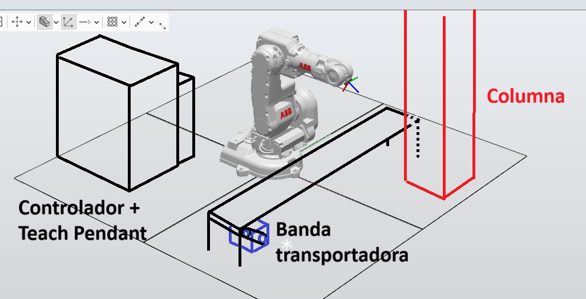
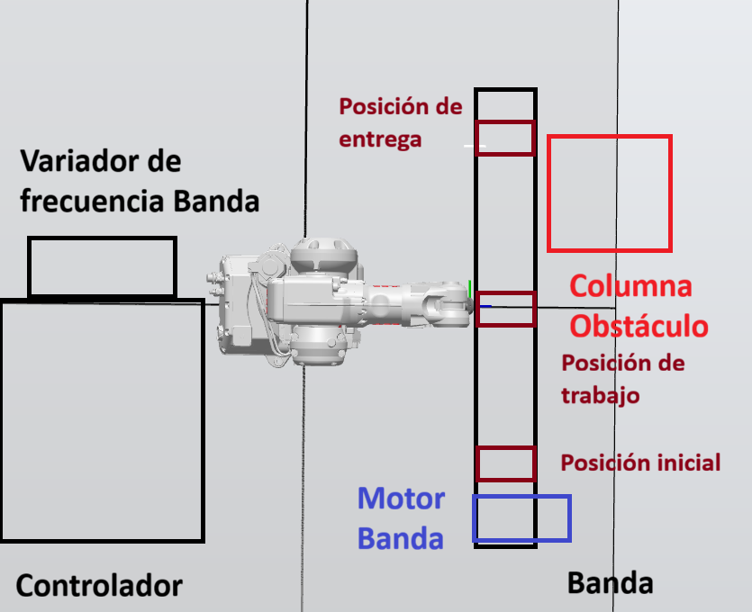
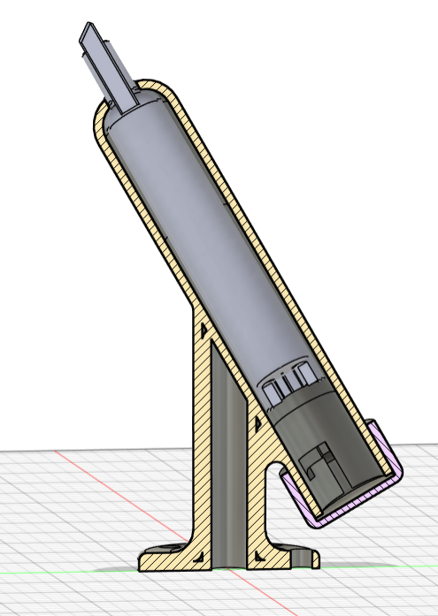
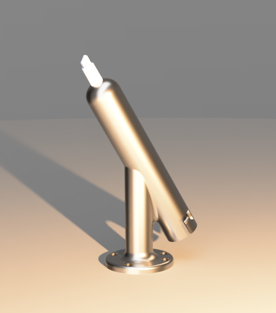
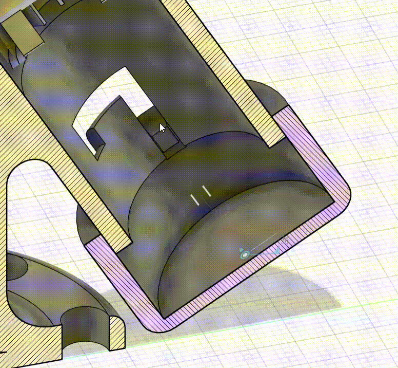
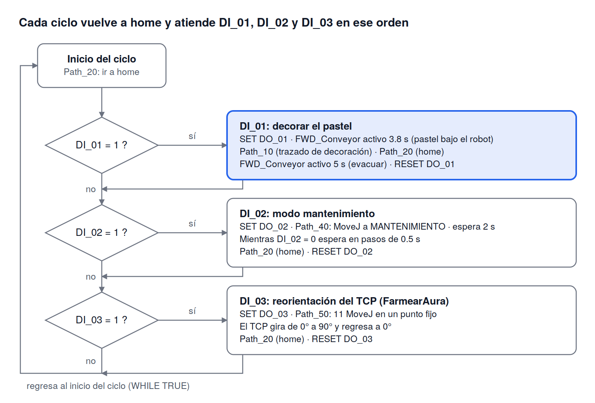

# Laboratorio No. 01 - Robótica Industrial - Trayectorias, Entradas y Salidas Digitales

  

## Video de la Práctica
[Ver Video en YouTube](https://www.youtube.com/watch?v=aElz2iVJS0k)

> **Nota:** El vídeo muestra tanto la simulación desarrollada en RobotStudio como la implementación final con el robot real.

---

## Problema 
En la industria de alimentos, particularmente en los procesos de panadería y repostería, diversas operaciones repetitivas pueden ser automatizadas utilizando robots industriales.

Una aplicación de este tipo corresponde a la decoración automática de tortas mediante el seguimiento controlado
de trayectorias

  

En los siguientes enlaces pueden observarse algunos ejemplos de automatización de procesos de decoración utilizando robots industriales:

[Enlace 1](https://www.youtube.com/watch?v=ROowhMuF15s)

[Enlace 2](https://www.youtube.com/watch?v=zf44RV27WsEs)

Inspirados en estos ejemplos y considerando las características de los equipos disponibles en el laboratorio, cada grupo debía desarrollar una celda simplificada para la decoración automática de una torta virtual.

## Descripción Detallada de la Solución Implementada

En primer lugar, se modeló la herramienta considerando los criterios clave detallados en la sección de [Diseño y modelo CAD de la herramienta](#diseño-y-modelo-cad-de-la-herramienta). Posteriormente, se llevó a cabo el proceso de calibración del Tool Center Point (TCP) mediante métodos tanto manuales como automáticos; el análisis comparativo entre ambos enfoques se profundiza en la sección de [Calibración de la herramienta](#3-comparación-de-la-calibración-de-la-herramienta-robotstudio-y-robot-real).

A continuación, se procedió con la definición del **Workobject (Wobj)**. Para la validación experimental con el robot real, se utilizó el empaque rígido de unos audífonos por su superficie plana y estabilidad estructural.

La trayectoria de trazado sobre la "torta" consiste en una superficie rectangular que integra las firmas de los integrantes del equipo (*Lijaman* y *Samuel*), junto con el dibujo de la Copa Pistón en la parte inferior. La geometría vectorial de las letras y la figura se diseñó en **Autodesk Fusion**. Para facilitar la generación de trayectorias en **RobotStudio** mediante la selección directa de vértices sobre el archivo `.SAT` importado, se optó por modelar la gráfica como un bajo relieve (extrusión interna).

La banda transporta la torta hasta la estación de trabajo del robot. Una vez ubicada dentro de su espacio de
trabajo, la banda se detiene completamente y el robot realiza la decoración.

Finalizada la operación, el robot regresa a su posición HOME y la banda transportadora se pone nuevamente en movimiento para trasladar la torta decorada hasta el extremo final de la banda.

Posteriormente se 

Se realizó un path y puso problemas al llegar al punto 

---

## Plano de Planta

Ubicación y distribución espacial de los elementos utilizados:

<table border="0" align="center" style="border-collapse: collapse;">
  <tr>
    <td align="center" valign="middle" style="border: none; padding: 10px;">
      
    </td>
    <td align="center" valign="middle" style="border: none; padding: 10px;">
      
    </td>
  </tr>
</table>

---

## Diseño y Modelo CAD de la Herramienta

### Diseño Detallado
En esta etapa fue fundamental considerar dos factores clave para optimizar la resistencia mecánica de la herramienta ante impactos:

La inclusión de redondeos en las aristas de acople entre geometrías para reducir la concentración de esfuerzos.

La integración de un resorte que proporciona un margen de tolerancia en la dirección normal, absorbiendo cargas imprevistas.

### Modelo CAD

<table border="0" align="center" style="border-collapse: collapse; margin-bottom: 40px;">
  <tr>
    <td align="center" valign="middle" style="border: none; padding: 10px;">
      
      
<b>Figura 1:</b> Vista en sección

    </td>
    <td align="center" valign="middle" style="border: none; padding: 10px;">
      
      
<b>Figura 2:</b> Render 3D

    </td>
  </tr>
</table>
Adicionalmente, se diseñó un mecanismo de agarre alternativo para la tapa trasera, el cual garantiza la fijación del conjunto y previene desacoples causados por vibraciones operativas:

  

---

## Diagrama de Flujo

El programa corre en un ciclo infinito (WHILE TRUE). En cada vuelta el robot regresa a home y consulta, en orden, tres entradas digitales. Las condiciones no son excluyentes: se evalúan una tras otra en la misma vuelta.

| Paso | Condición | Acciones del robot y de las E/S |
|---|---|---|
| 0 | Arranque de `main` | Entra al ciclo `WHILE TRUE` |
| 1 | Siempre | `Path_20`: `MoveJ` a `Target_home` (referencia `wobj0`) |
| 2 | `DI_01 = 1` (decorar pastel) | `SET DO_01` → `SET FWD_Conveyor` → espera 3.8 s → `RESET FWD_Conveyor` → `Path_10` (trayectoria de decoración) → `Path_20` (home) → `SET FWD_Conveyor` → espera 5 s → `RESET FWD_Conveyor` → `RESET DO_01` |
| 3 | `DI_02 = 1` (modo mantenimiento) | `SET DO_02` → `Path_40` (`MoveJ` a `MANTENIMIENTO`) → espera 2 s → mientras `DI_02 = 0` espera 0.5 s → `Path_20` (home) → `RESET DO_02` |
| 4 | `DI_03 = 1` (secuencia de reorientación) | `SET DO_03` → `FarmearAura` (`Path_50`) → `Path_20` (home) → `RESET DO_03` |
| 5 | Fin de la vuelta | Regresa al paso 1 |

La figura del diagrama de flujo se incluye a continuación:

---

## Instrucciones y Funciones de RAPID

### 2.1 Estructura del programa

| Elemento | Descripción |
|---|---|
| `MODULE Module1 … ENDMODULE` | Módulo único que contiene datos, trayectorias y programa principal |
| `PROC main()` | Punto de entrada: ciclo infinito con la lógica |
| `PROC Path_10()` | Trayectoria de decoración del pastel (≈ 253 `MoveL` y 1 `MoveJ` inicial, más 3 `MoveJ` de reposicionamiento) |
| `PROC Path_20()` | Ir a la posición *home* |
| `PROC Path_40()` | Ir a la posición de mantenimiento |
| `PROC Path_50()` | Barrido de orientación del TCP en un punto fijo (11 `MoveJ`) |
| `PROC FarmearAura()` | Procedimiento contenedor que solo llama a `Path_50` |

Los procedimientos sin parámetros se llaman escribiendo solo su nombre (por ejemplo `Path_20;`), lo que permite estructurar el programa de forma modular.

### 2.2 Tipos de datos

| Tipo | Uso en el código | Detalle |
|---|---|---|
| `tooldata` | `marcador` | `[robhold, tframe, tload]`. `TRUE`: la herramienta va sujeta al robot. TCP en `[38.907, -1, 151.09]` mm respecto a la brida; orientación `[0.9659, 0, 0.2588, 0]` (rotación de 30° sobre Y); carga de 1 kg con centro de gravedad `[0,0,1]` |
| `wobjdata` | `Workobject_pastel` | `[robhold, ufprog, ufmec, uframe, oframe]`. `FALSE`: objeto fijo (no sujeto por el robot). `TRUE`: sistema de usuario fijo programado. `uframe` en `[644.76, -106.22, 117.65]` con orientación `[0,0,1,0]` (giro de 180° sobre Y, por lo que el eje Z del objeto apunta hacia abajo); `oframe` sin desplazamiento |
| `robtarget` | 272 objetivos (`Target_10` … `Target_2670_2`, `MANTENIMIENTO`, `Target_home`) | `[trans, rot, robconf, extax]`: posición XYZ en mm, orientación en cuaternión, configuración de ejes `[cf1, cf4, cf6, cfx]` y ejes externos sin usar (`9E+09`) |
| `speeddata` | `v100` | Velocidad del TCP de 100 mm/s |
| `zonedata` | `z5` | Zona de paso de 5 mm (trayectoria redondeada) |
| Señales | `DI_01..03`, `DO_01..03`, `FWD_Conveyor` | Entradas y salidas digitales del controlador |

`CONST` se usa para los objetivos (valores que no cambian) y `PERS` para `tooldata`/`wobjdata` (datos persistentes que el sistema puede actualizar, por ejemplo tras una calibración).

### 2.3 Instrucciones de movimiento

| Instrucción | Función | Ejemplo del código |
|---|---|---|
| `MoveJ` | Movimiento articular de un punto a otro del espacio que no sigue una trayectoria fija. Se usa para aproximaciones y cambios de zona | `MoveJ Target_home,v100,z5,marcador\WObj:=wobj0;` |
| `MoveL` | Movimiento lineal del TCP. Se usa en todo el trazado para que los trazos sean rectos | `MoveL Target_20,v100,z5,marcador\WObj:=Workobject_pastel;` |
| `\WObj` | Argumento opcional que indica el objeto de trabajo en cuyas coordenadas está definido el `robtarget`. `wobj0` es el sistema de la base del robot | `\WObj:=Workobject_pastel` |
---

### 2.4 Instrucciones y lógica

| Instrucción | Función | Uso en el código |
|---|---|---|
| `SET señal` | Pone una salida digital en 1 | `SET DO_01; SET FWD_Conveyor;` |
| `RESET señal` | Pone una salida digital en 0 | `RESET FWD_Conveyor; RESET DO_01;` |
| `IF … THEN … ENDIF` | Ejecución condicional | `IF DI_01 = 1 THEN … ENDIF` |
| `WHILE … DO … ENDWHILE` | Ciclo condicional | `WHILE TRUE DO` (ciclo principal) y `WHILE DI_02=0 DO` (espera) |
| `WaitTime t` | Pausa de t segundos | `WaitTime 3.8;` (avance de banda), `WaitTime 0.5;` |
| Llamada a procedimiento | Ejecuta un `PROC` | `Path_10;` `Path_20;` `FarmearAura;` |

### 2.5 Entradas digitales (pulsadores)

El sistema se opera con tres pulsadores conectados a las entradas digitales del controlador. Cada uno inicia una rutina distinta, y la salida digital asociada se activa mientras la rutina se ejecuta.

| Señal | Elemento | Acción que dispara | Salida asociada |
|---|---|---|---|
| `DI_01` | Entrada digital 1: Pulsador 1 | Ciclo de decoración: avanza la banda 3.8 s, ejecuta `Path_10`, vuelve a *home* y evacua el pastel con la banda 5 s | `DO_01` y `FWD_Conveyor` |
| `DI_02` | Entrada digital 2: Pulsador 2 | Modo mantenimiento: lleva el robot a la posición `MANTENIMIENTO` (`Path_40`). Una segunda pulsación lo devuelve a *home* | `DO_02` |
| `DI_03` | Entrada digital 3: Pulsador 3 | Secuencia `FarmearAura`: el TCP gira de 0° a 90° y regresa a 0° en un punto fijo (`Path_50`) | `DO_03` |

## Comparación de Calibración de la Herramienta

## 3. Comparación de la calibración de la herramienta: RobotStudio y robot real

### 3.1 Datos de calibración

| Fuente | Herramienta | Origen |
|---|---|---|
| `PERS tooldata PuntaMarcador` | `PuntaMarcador` | RobotStudio: herramienta definida por su geometría en la simulación |
| `Calibracion herramienta con robot` | `lijatool` y módulo `TCP_lijatool2` con 4 puntos `pTCP_Point1..4` | Robot real: calibración del TCP con el método de 4 puntos |

### 3.2 Calibración de 4 puntos con el robot real

La herramienta `lijatool` quedó con TCP `[41.4053, -0.941058, 152.516]`, orientación `[1,0,0,0]` y carga de 1 kg. El módulo `TCP_lijatool2` guarda las cuatro poses del robot con orientaciones diferentes (`pTCP_Point1` a `pTCP_Point4`), tal como exige el método: la punta de la herramienta se lleva al mismo punto fijo desde cuatro orientaciones y el controlador calcula la posición del TCP.

[Video de la calibración manual: ](Imagenes/Calibracion.mp4)

<video src="Imagenes/Calibracion.mp4" controls width="100%">
</video>

### 3.3 Calibración en RobotStudio

Se importó un archivo `.sat` con el modelo de la herramienta (el marcador) y se calibró el *tool* tomando como TCP un punto de ese modelo, la punta del marcador. A partir de ese punto, RobotStudio calcula la posición del TCP respecto a la brida del robot y genera el `tooldata` correspondiente:

| Parámetro | Valor (`PuntaMarcador`) |
|---|---|
| Posición del TCP (mm) | `[38.039, -2, 150.586]` |
| Orientación (cuaternión) | `[0.9659, 0, 0.2588, 0]` (30° sobre Y) |
| Masa / centro de gravedad | 1 kg / `[0, 0, 1]` mm |

[Video de la calibración en Robot Studio: ](Imagenes/Prueba_de_calibración_Robot_Studio.mp4)

### 3.4 Herramienta: RobotStudio frente a calibración con el robot real

La comparación se hace sobre los datos de `tooldata` de cada herramienta. Las posiciones del TCP están expresadas respecto a la brida del robot (`tool0`), por lo que son comparables entre sí.

| Parámetro | RobotStudio (`PuntaMarcador`) | Robot real (`lijatool`, 4 puntos) | Diferencia (real − RobotStudio) |
|---|---|---|---|
| X (mm) | 38.039 | 41.405 | +3.366 |
| Y (mm) | −2.000 | −0.941 | +1.059 |
| Z (mm) | 150.586 | 152.516 | +1.930 |
| Longitud del TCP (mm) | 155.33 | 158.04 | +2.71 |
| Orientación (cuaternión) | `[0.9659, 0, 0.2588, 0]` (30° sobre Y) | `[1, 0, 0, 0]` (sin rotación) | 30° sobre Y |
| Masa (kg) | 1 | 1 | 0 |
| Centro de gravedad (mm) | `[0, 0, 1]` | `[0, 0, 0]` | 1 mm en Z |

**Distancia total entre ambos TCP: 4.02 mm** (3.53 mm en el plano XY y 1.93 mm en Z).

**Análisis**

- Las dos calibraciones coinciden en el orden de magnitud (TCP de unos 155 a 158 mm), pero el TCP del robot real queda desplazado unos 4 mm respecto al de RobotStudio, sobre todo en X (+3.4 mm).
- La orientación no es comparable directamente: el método de 4 puntos solo determina la posición del TCP y deja la orientación en `[1,0,0,0]`. La inclinación de 30° de `PuntaMarcador` solo existe en el modelo de RobotStudio.
- La masa coincide y el centro de gravedad difiere solo 1 mm; en ambos casos son valores nominales, no medidos.

### 3.5 Comparación del método

| Aspecto | RobotStudio | Robot real |
|---|---|---|
| Cómo se obtiene el TCP | Se calcula a partir de la geometría/CAD de la herramienta | Se mide moviendo el robot a 4 poses con la punta en el mismo punto |
| Precisión | Exacta respecto al modelo, pero ignora holguras de montaje y fabricación | Incluye el montaje real, pero depende de la habilidad del operador al alinear la punta |
| Orientación del TCP | Se define directamente (aquí 30° sobre Y) | El método de 4 puntos solo determina posición; la orientación queda `[1,0,0,0]` salvo que se usen más puntos (Z/X) |
| Carga (`tload`) | Valor nominal | Valor nominal; no se calibró dinámicamente |
| Tiempo y riesgo | Rápido y sin riesgo de colisión | Requiere el robot, tiempo y cuidado con la punta |

### 3.6 Objeto de trabajo (WorkObject)

El objeto de trabajo se calibró únicamente en RobotStudio. Para ello se usó otro archivo `.sat` que contiene la forma del objeto (el pastel) y la figura de la trayectoria que debe seguir el robot. Con el origen del objeto de trabajo definido sobre este modelo, los objetivos de la trayectoria quedan expresados en sus coordenadas, de modo que el trazado depende del objeto y no de la posición del robot.

| Parámetro | Valor (`Workobject_pastel`) |
|---|---|
| Origen X, Y, Z (mm) | `[644.76, -106.22, 117.65]` |
| Orientación (cuaternión) | `[0, 0, 1, 0]` (giro de 180° sobre Y; el eje Z apunta hacia abajo) |
| Tipo | Objeto fijo (`robhold = FALSE`), sistema de usuario programado (`ufprog = TRUE`) |

A diferencia de la herramienta, el objeto de trabajo no se recalibró con el robot real. Por lo tanto, su precisión depende de que la ubicación física del pastel y de la banda coincida con la del modelo en la simulación.

### 3.7 Conclusiones

- El TCP calibrado con el robot real difiere 4.02 mm del definido en RobotStudio, con la mayor diferencia en X.
- La orientación de la herramienta solo se definió en RobotStudio, porque el método de 4 puntos no la calibra.
- La calibración real incluye el montaje físico de la herramienta, pero depende de la precisión con que se alinea la punta al tomar los cuatro puntos; la de RobotStudio es exacta respecto al modelo, pero no considera las tolerancias del montaje.
- Si se requiere calibrar también la orientación del TCP en el robot real, se puede complementar con el método de 5 o 6 puntos.
---

## Código Completo en RAPID
[Código Completo de RAPID](Modulo_RAPID_LAB1.mod)
