# Laboratorio No. 02 - Robótica Industrial: Motoman MH6 y RoboDK


**Fecha de la práctica:** [11/11/2026]


## Objetivo

Comparar el Motoman MH6 y el ABB IRB140, documentar la operación manual del Motoman y diseñar, simular y ejecutar una trayectoria polar desde RoboDK con el manipulador físico controlado desde el PC.

## Contenido

1. [Comparación técnica de los manipuladores](#1-comparación-técnica-de-los-manipuladores)
2. [Configuraciones home1 y home2](#2-configuraciones-home1-y-home2)
3. [Procedimiento de movimientos manuales](#3-procedimiento-de-movimientos-manuales)
4. [Niveles de velocidad manual](#4-niveles-de-velocidad-manual)
5. [RoboDK y comunicación con el Motoman](#5-robodk-y-comunicación-con-el-motoman)
6. [Comparación entre RoboDK y RobotStudio](#6-comparación-entre-robodk-y-robotstudio)
7. [Diagrama de flujo de acciones del robot](#7-diagrama-de-flujo-de-acciones-del-robot)
8. [Plano de planta de la celda](#8-plano-de-planta-de-la-celda)
9. [Código desarrollado](#9-código-desarrollado)
10. [Videos de simulación e implementación física](#10-videos-de-simulación-e-implementación-física)
11. [Referencias](#referencias)

## 1. Comparación técnica de los manipuladores

A continuación se presenta la comparación de las características técnicas de los dos robots industriales Motoman MH6 vs ABB IRB 140.

### Características generales

| Característica | Motoman MH6 | ABB IRB 140 |
|---|---|---|
| **Fabricante** | Yaskawa Motoman (Japón) | ABB Robotics (Suiza/Suecia) |
| **Tipo** | Articulado vertical | Articulado vertical |
| **Carga máxima (payload)** | 6 kg | 6 kg |
| **Alcance máximo** | 1422 mm | 810 mm |
| **Grados de libertad** | 6 (8 en la instalación completa: 6 del manipulador, 1 de la banda inferior, 1 del eje externo) | 6 |
| **Precisión** | ±0,08 mm | ±0,03 mm |
| **Peso del robot** | ≈ 130 kg | ≈ 98 kg |
| **Controlador** | DX100 / DX200 | IRC5 |
| **Lenguaje de programación** | INFORM (controlador) PYTHON (RoboDK) | RAPID |
| **Montaje** | Suelo, pared, techo | Suelo, pared, invertido, inclinado |
| **Protección** | IP54 (muñeca IP67) | IP67 |
| **Aplicaciones típicas** | Soldadura por arco, manipulación, ensamblaje, dispensado, atención de máquinas | Soldadura por arco, ensamblaje, manipulación, atención de máquinas, empaquetado, limpieza/pintura, desbarbado |

### Rango de movimiento por eje

| Eje | MH6 | IRB 140 |
|---|---|---|
| Eje 1 (base) | ±170° | ±180° |
| Eje 2 (hombro) | +155° / −90° | +110° / −90° |
| Eje 3 (codo) | +250° / −175° | +50° / −230° |
| Eje 4 (antebrazo) | ±180° | ±200° |
| Eje 5 (muñeca) | +225° / −45° | ±115° |
| Eje 6 (brida) | ±360° | ±400° |

### Velocidad máxima por eje

| Eje | MH6 | IRB 140 |
|---|---|---|
| Eje 1 | 220 °/s | 200 °/s |
| Eje 2 | 200 °/s | 200 °/s |
| Eje 3 | 220 °/s | 260 °/s |
| Eje 4 | 410 °/s | 360 °/s |
| Eje 5 | 410 °/s | 360 °/s |
| Eje 6 | 610 °/s | 450 °/s |

### Análisis

- **Alcance:** el Motoman MH6 ofrece un volumen de trabajo mucho mayor (1422 mm frente a 810 mm), ideal para celdas amplias o piezas grandes.
- **Precisión:** el IRB 140 es más preciso (±0,03 mm vs ±0,08 mm), útil en ensamblaje fino y tareas de alta exactitud.
- **Compacidad:** el IRB 140 es más ligero y compacto, con protección IP67 en todo el robot, lo que facilita su uso en espacios reducidos y entornos exigentes.
- **Carga:** ambos manejan 6 kg, por lo que la elección depende del alcance, la precisión y el ecosistema (controlador y software).
- **Programación:** el MH6 usa PYTHON; el IRB 140 usa RAPID (IRC5).

## 2. Configuraciones home1 y home2

El controlador del Motoman MH6 permite definir posiciones de referencia (*home*). Aquí se describen dos: **Home 1** (posición por defecto de fábrica) y **Home 2** (posición con los encoders en cero).

---

### Home 1: posición por defecto de fábrica

El Home 1 es la posición de origen con la que el robot se entrega de fábrica. El brazo queda plegado y compacto, lo que facilita su transporte y almacenamiento.

<table>
  <tr>
    <td align="center">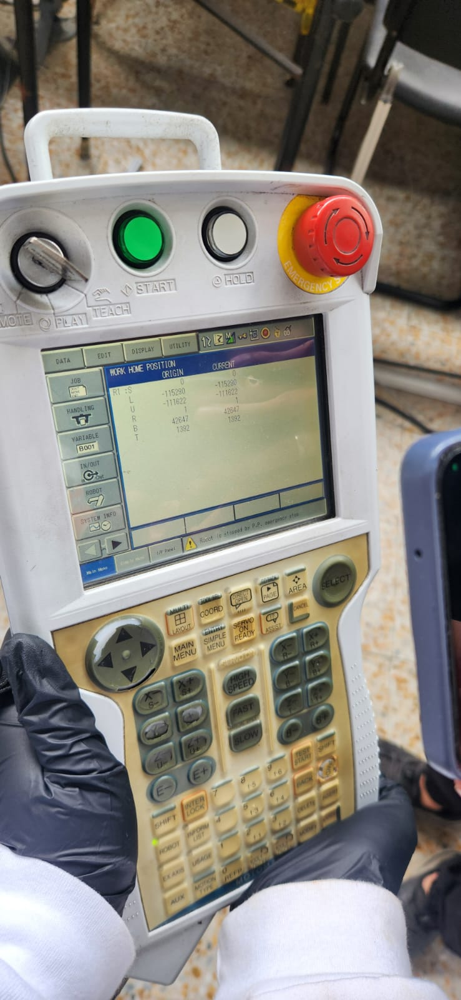<br><em>Pendant: WORK HOME POSITION</em></td>
    <td align="center">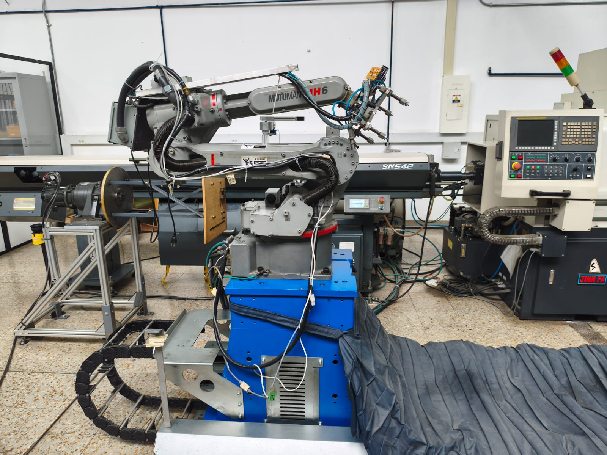<br><em>MH6 en la posición Home 1</em></td>
  </tr>
</table>

**Posición de cada articulación en Home 1**

| Articulación | Eje | ORIGIN (pulsos) | CURRENT (pulsos) |
|:---:|:---:|---:|---:|
| Base (giro) | S | 0 | 0 |
| Hombro | L | −115290 | −115290 |
| Codo | U | −111622 | −111622 |
| Antebrazo (giro) | R | 1 | 1 |
| Muñeca (flexión) | B | 42647 | 42647 |
| Brida (giro) | T | 1392 | 1392 |

---

### Home 2: posición con los encoders en cero

En el Home 2 (*Second Home Position*) los encoders de todos los servomotores están en (o muy cerca de) cero. El brazo queda extendido verticalmente, lo que facilita el trabajo con el robot: sirve como referencia clara para calibrar, programar trayectorias y verificar cada eje.

<table>
  <tr>
    <td align="center">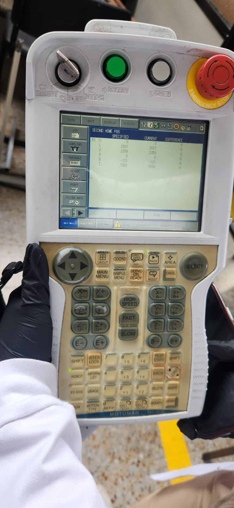<br><em>Pendant: SECOND HOME POS</em></td>
    <td align="center">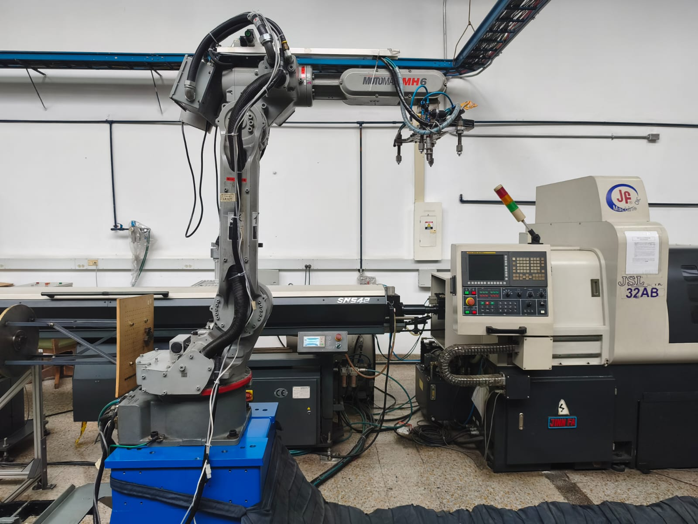<br><em>MH6 en la posición Home 2</em></td>
  </tr>
</table>

**Posición de cada articulación en Home 2**

| Articulación | Eje | SPECIFIED (pulsos) | CURRENT (pulsos) | DIFFERENCE |
|:---:|:---:|---:|---:|---:|
| Base (giro) | S | 0 | 0 | 0 |
| Hombro | L | 2037 | 2037 | 0 |
| Codo | U | 2359 | 2359 | 0 |
| Antebrazo (giro) | R | 0 | 0 | 0 |
| Muñeca (flexión) | B | −121 | −121 | 0 |
| Brida (giro) | T | 1392 | 1392 | 0 |

> **Nota:** los valores  de las articulaciones están en pulsos de encoder. En el Home 2 son cercanos a cero, no exactamente cero, por pequeñas compensaciones de calibración.

---

### Comparación

| Aspecto | Home 1 | Home 2 |
|---|---|---|
| **Definición** | Posición por defecto de fábrica | Posición con encoders en cero |
| **Postura del brazo** | Plegado y compacto | Extendido verticalmente |
| **Uso principal** | Transporte y almacenamiento | Trabajo, calibración y programación |
| **Valores de los ejes** | Altos (±100 000 pulsos en L y U) | Cercanos a cero |

### ¿Cuál posición es mejor?

Para trabajar con el robot, el Home 2 es mejor:

1. **Referencia clara:** con los encoders en cero, cada eje tiene un punto de partida inequívoco.
2. **Facilidad de programación:** la postura extendida es intuitiva para planificar trayectorias.
3. **Mayor visibilidad y acceso:** el brazo extendido deja libre el espacio y permite inspeccionar las articulaciones.
4. **Menor riesgo de error:** los valores cercanos a cero son fáciles de leer y comparar.

El Home 1 es mejor para transportar o guardar el robot por su postura compacta. En conclusión: Home 1 es la posición de entrega y transporte; Home 2 es la de trabajo y referencia.

## 3. Procedimiento de movimientos manuales

El movimiento manual (*jog*) se realiza desde el teach pendant del DX100. Permite mover el manipulador de dos formas principales: por articulaciones (cada eje por separado) o en coordenadas cartesianas (el efector final se traslada y rota en los ejes X, Y, Z).

### 1. Elementos del pendant que se utilizan

<p align="center">
  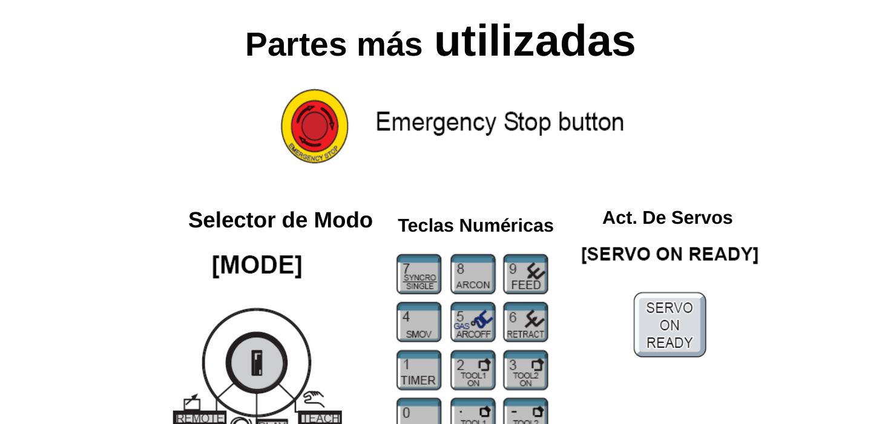
</p>

| Elemento | Función |
|---|---|
| **Selector de modo (MODE)** | Es una llave que permite la selección de modos REMOTE, PLAY o TEACH. El movimiento manual se hace en TEACH. |
| **SERVO ON READY** | Habilita la alimentación de los servomotores. |
| **Enable switch (hombre muerto)** | Interruptor de 3 posiciones en la parte trasera del pendant; al apretarlo suavemente se energizan los servos. |
| **COORD** | Cambia el sistema de coordenadas de movimiento manual. |
| **Teclas de ejes** | Mueven cada eje o dirección (S, L, U, R, B, T / X, Y, Z). |
| **Paro de emergencia** | Corta la energía de los servos en cualquier momento. |

### 2. Preparación y activación de los servos

Antes de mover el robot, hay que verificar que no haya personas ni obstáculos dentro de su espacio de trabajo y ten siempre a la mano el paro de emergencia.

1. Girar el selector de modo a la posición TEACH.
2. Liberar el paro de emergencia (gíralo en el sentido de la flecha).
3. Presionar [SERVO ON READY]. La luz *SERVO ON* comenzará a parpadear.
4. Apretar suavemente el Enable switch de la parte trasera del pendant. La luz *SERVO ON* quedará encendida fija y se escuchará liberarse los frenos de los motores.
5. Mientras mantengas el Enable switch en su posición intermedia, el robot puede moverse con las teclas de ejes.

<p align="center">
  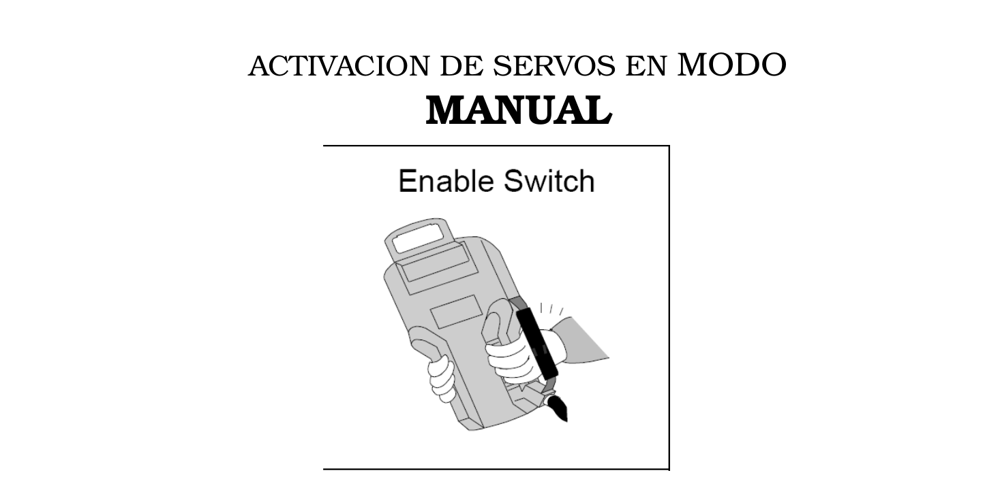
</p>

Si se suelta el Enable switch, se aprieta a fondo, los servos se apagan inmediatamente. Para volver a activarlos, hay que repetir los pasos 3 y 4.

### 3. Selección del sistema de coordenadas

La tecla [COORD] cambia entre los sistemas de coordenadas disponibles. Cada pulsación pasa al siguiente, y el icono de la pantalla muestra el modo activo.

<p align="center">
  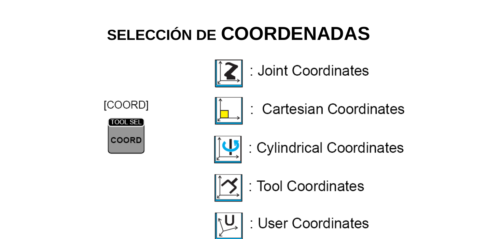
</p>

| Icono | Sistema | Descripción |
|---|---|---|
| Joint | **Articulaciones** | Cada tecla mueve un eje individual del robot. |
| Cartesian | **Cartesiano** | El TCP se mueve en líneas rectas X, Y, Z respecto a la base del robot. |
| Cylindrical | **Cilíndrico** | Movimiento en coordenadas cilíndricas (giro, radio y altura). |
| Tool | **Herramienta** | Los ejes X, Y, Z están fijos a la herramienta y se mueven con ella. |
| User | **Usuario** | Los ejes se definen respecto a un sistema creado por el usuario. |

### 4. Movimiento por articulaciones (modo Joint)

Para pasar a este modo, presiona [COORD] hasta que aparezca el icono de Joint en la pantalla. Cada par de teclas mueve un eje del robot:

<p align="center">
  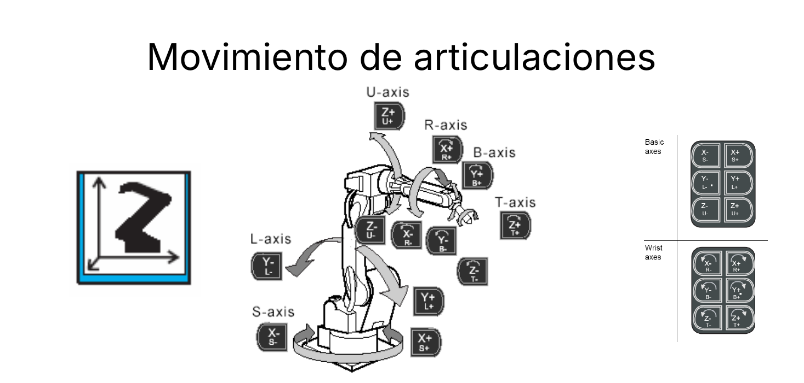
</p>

| Eje | Articulación | Tecla − | Tecla + |
|:---:|---|:---:|:---:|
| **S** | Base (giro) | `X-/S-` | `X+/S+` |
| **L** | Hombro | `Y-/L-` | `Y+/L+` |
| **U** | Codo | `Z-/U-` | `Z+/U+` |
| **R** | Antebrazo (giro) | `X-/R-` | `X+/R+` |
| **B** | Muñeca (flexión) | `Y-/B-` | `Y+/B+` |
| **T** | Brida (giro) | `Z-/T-` | `Z+/T+` |

Pasos:

1. Activa los servos (sección 2).
2. Presiona [COORD] hasta seleccionar Joint.
3. Mantén apretado el Enable switch y mantén presionada la tecla del eje y sentido deseado: el eje se mueve mientras la tecla esté presionada.
4. Suelta la tecla para detener el movimiento.

### 5. Movimiento cartesiano: traslaciones y rotaciones en X, Y, Z

Presiona [COORD] hasta que aparezca el icono de Cartesian. Las mismas teclas ahora mueven el robot en el espacio de trabajo, en lugar de mover cada articulación:

<p align="center">
  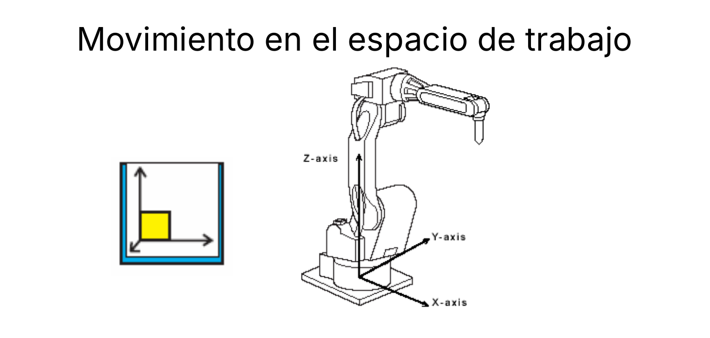
</p>

| Movimiento | Tecla − | Tecla + | Efecto |
|---|:---:|:---:|---|
| **Traslación en X** | `X-` | `X+` | El TCP se mueve a lo largo del eje X. |
| **Traslación en Y** | `Y-` | `Y+` | El TCP se mueve a lo largo del eje Y. |
| **Traslación en Z** | `Z-` | `Z+` | El TCP sube o baja a lo largo del eje Z. |
| **Rotación sobre X** | `X-` (derecha) | `X+` (derecha) | La herramienta gira alrededor del eje X. |
| **Rotación sobre Y** | `Y-` (derecha) | `Y+` (derecha) | La herramienta gira alrededor del eje Y. |
| **Rotación sobre Z** | `Z-` (derecha) | `Z+` (derecha) | La herramienta gira alrededor del eje Z. |

Pasos:

1. Activa los servos (sección 2).
2. Presiona [COORD] hasta seleccionar Cartesian.
3. Con el Enable switch apretado, mantén presionada la tecla del eje (X, Y o Z) y el sentido (+ o −) para trasladar, o la tecla del grupo derecho para rotar la herramienta.
4. Suelta la tecla para detener el movimiento.

### 6. Movimiento en coordenadas de herramienta

En modo Tool, los ejes X, Y, Z están fijados a la herramienta, por lo que el movimiento es siempre relativo a su orientación. Es útil para acercar o alejar la herramienta de una pieza sin importar cómo esté inclinada.

<p align="center">
  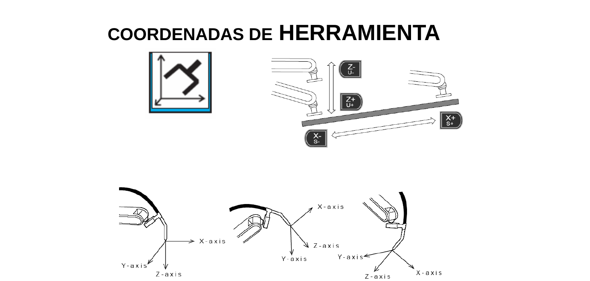
</p>

### 7. Resumen del procedimiento

```
1. MODE → TEACH
2. Liberar paro de emergencia
3. SERVO ON READY 
4. Enable switch apretado suavemente 
5. COORD → elegir Joint / Cartesian / Cylindrical / Tool / User
6. Mantener tecla de eje → el robot se mueve
7. Soltar tecla → el robot se detiene
```


## 4. Niveles de velocidad manual

La velocidad manual determina qué tan rápido se mueve el manipulador cuando se presiona una tecla de eje en modo TEACH. El DX100 ofrece cuatro niveles, que se cambian con las teclas [FAST] y [SLOW] del pendant, y el nivel activo se muestra en todo momento en la pantalla.

### 1. Niveles de velocidad disponibles

<p align="center">
  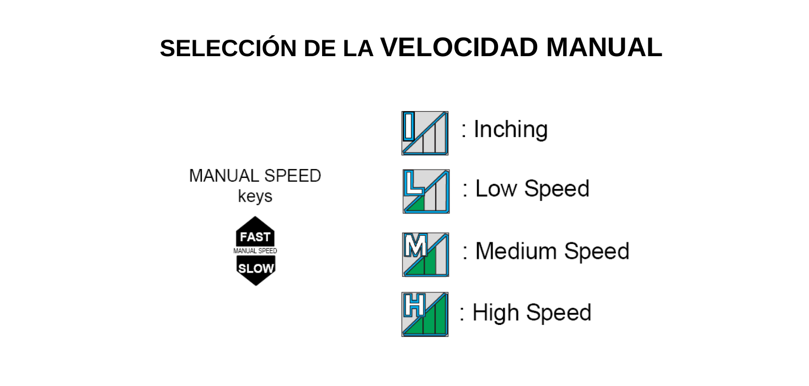
</p>

| Nivel | Indicación en pantalla | Descripción | Uso recomendado |
|---|:---:|---|---|
| **Inching** | `INCH` | Movimiento por pasos: cada pulsación de la tecla de eje produce un desplazamiento incremental muy pequeño. | Posicionamiento fino y ajuste preciso de puntos. |
| **Low** (baja) | `SLW` | Velocidad lenta y continua mientras se mantiene presionada la tecla. | Aproximaciones cercanas a piezas, herramientas u obstáculos. |
| **Medium** (media) | `MED` | Velocidad intermedia. | Movimientos generales de trabajo y enseñanza de puntos. |
| **High** (alta) | `FST` | Velocidad rápida. | Desplazamientos grandes en zonas despejadas. |

Siempre se recomienda iniciar en velocidad baja y aumentarla solo cuando la trayectoria esté despejada y el operador tenga control total de la situación.

### 2. Proceso para cambiar entre niveles

Los niveles se recorren de forma cíclica con las dos teclas de velocidad manual (*MANUAL SPEED*), ubicadas en el teclado del pendant:

| Tecla | Efecto | Secuencia |
|:---:|---|---|
| **[FAST]** | Aumenta el nivel de velocidad en cada pulsación. | `INCH` → `SLW` → `MED` → `FST` |
| **[SLOW]** | Disminuye el nivel de velocidad en cada pulsación. | `FST` → `MED` → `SLW` → `INCH` |

Pasos:

1. Gira el selector de modo a TEACH.
2. Observa en el área de estado cuál es el nivel de velocidad actual.
3. Presiona [FAST] para subir o [SLOW] para bajar un nivel por pulsación.
4. Verifica en el área de estado que el icono corresponda al nivel deseado.
5. Mueve el robot con las teclas de ejes a la velocidad seleccionada.

El cambio de velocidad se puede hacer en cualquier momento, incluso con el robot detenido. El nuevo nivel se aplicará al siguiente movimiento.

### 3. Botón [HIGH SPEED]

El botón [HIGH SPEED] permite mover el robot a una velocidad alta de forma momentánea, sin cambiar el nivel configurado:

- Se debe mantener presionado junto con una tecla de eje.
- Al soltarla, el robot vuelve a moverse al nivel de velocidad seleccionado.
- La velocidad de [HIGH SPEED] está definida previamente en el controlador.
- No funciona cuando el nivel seleccionado es `INCH`.

### 4. Identificar el nivel establecido en la interfaz

El nivel de velocidad activo se muestra en el área de estado, en la parte superior derecha de la pantalla del pendant.

<p align="center">
  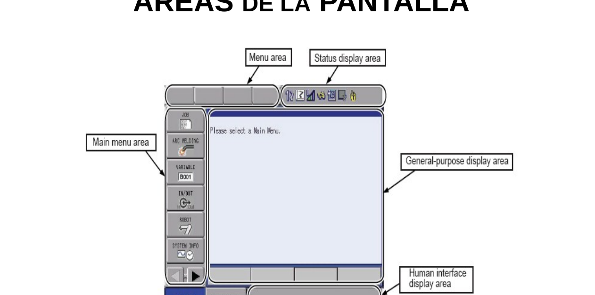
</p>

Dentro del área de estado, el icono de velocidad manual es el tercero de izquierda a derecha (indicador C en la imagen), a continuación del icono de grupo de ejes (A) y del icono del sistema de coordenadas (B):

<p align="center">
  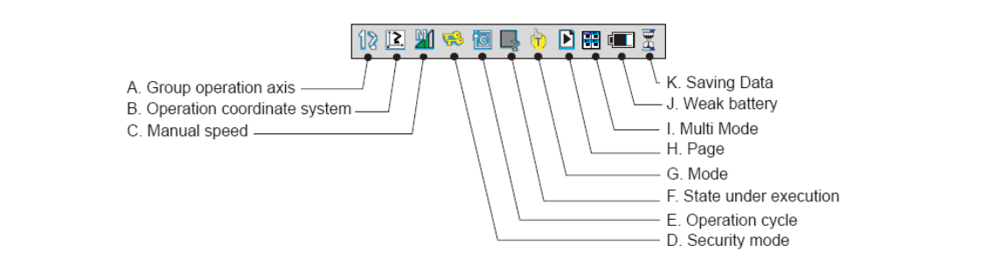
</p>

| Indicador | Nombre | Qué muestra |
|:---:|---|---|
| A | Group operation axis | Grupo de ejes que se está moviendo (robot o ejes externos. En nuestro caso existe un eje externo.). |
| B | Operation coordinate system | Sistema de coordenadas activo (Joint, Cartesian, etc.). |
| **C** | **Manual speed** | **Nivel de velocidad manual: Inching, Low, Medium o High.** |
| D | Security mode | Modo de seguridad. |

El icono de velocidad cambia de apariencia según el nivel: las barras de la gráfica aumentan de altura a medida que sube la velocidad, y para el nivel Inching aparece una sola barra marcada. Cada vez que se presiona [FAST] o [SLOW], el icono se actualiza de inmediato.

### Referencias

- Yaskawa. *DX100 Operator's Manual*, sección 2.2.0.5 "Select Manual Speed" y sección 1.2 "Programming Pendant".
- Ramírez, R., Cárdenas, P. *Fundamentos de Robótica Industrial*. Universidad Nacional de Colombia (diapositivas "Selección de la velocidad manual" y "Área de estado").

## 5. RoboDK y comunicación con el Motoman

### 5.1. Funcionalidades principales

Para esta práctica se partió de una estación de ejemplo suministrada por el docente, que ya contenía el manipulador, la herramienta, las referencias y la geometría del entorno. El trabajo del equipo se concentró en programar la trayectoria mediante Python y definir el target de inicio y retorno. A continuación se describen las funcionalidades más relevantes y cómo se relacionaron con el laboratorio.

#### Biblioteca de robots y herramientas

RoboDK dispone de una biblioteca de modelos de robots y herramientas que facilita la construcción de estaciones de trabajo virtuales. Permite incorporar un manipulador compatible y los elementos necesarios para representar su aplicación. En este laboratorio no se seleccionaron ni descargaron estos componentes desde la biblioteca, ya que estaban incluidos en el archivo inicial del docente.

#### Sistemas de referencia y definición de herramienta

Los sistemas de referencia permiten expresar la posición y orientación de los puntos respecto a una base, una superficie de trabajo o una herramienta. Esto resulta especialmente útil para dibujar sobre un plano inclinado: la trayectoria puede definirse en las coordenadas locales del plano y ubicarse en la estación mediante la transformación de ese marco.

En la estación suministrada se identificaron las siguientes referencias:

| Referencia | Función en la estación |
|---|---|
| `Motoman MH6 Base` | Marco asociado a la base del manipulador, que sirve como referencia para ubicar el robot en la estación. |
| `Frame_from_Target1` | Marco asociado al plano inclinado donde se dibuja la figura. Permite definir el recorrido con respecto a la superficie de trabajo. |
| `Ventosas` | Herramienta con su marco de TCP (*Tool Center Point*), que define el punto y la orientación de trabajo respecto a la brida del robot. |
| `Motoman MH6 (brida de montaje)` | Marco de la brida del robot (*flange*): referencia del extremo mecánico del manipulador donde se monta la herramienta. |

Aunque todos representan sistemas de coordenadas, no todos son elementos de tipo *Frame* en el árbol de RoboDK: el TCP pertenece a la herramienta y la referencia de la brida pertenece al robot. La transformación entre ambos describe el desplazamiento y la orientación de la herramienta montada.

El equipo utilizó estas referencias ya configuradas por el docente. No creó ni calibró nuevos marcos; el script selecciona el marco de trabajo mediante `setPoseFrame()` y conserva la definición de herramienta mediante `setPoseTool(robot.PoseTool())`.

#### Targets o posiciones objetivo

Los *targets* permiten guardar posiciones objetivo del robot, mediante valores articulares o mediante una pose cartesiana de la herramienta respecto a una referencia. Pueden reutilizarse en distintas instrucciones del programa.

El único target creado por el equipo como elemento independiente en el árbol de la estación fue `Home`. Corresponde a **home1, la configuración de transporte**, y se utilizó tanto al inicio como al final de la trayectoria. En el script se obtiene con `RDK.Item("Home", ITEM_TYPE_TARGET)` y se alcanza mediante `robot.MoveJ(T_H)`. Los demás puntos del recorrido se calculan desde Python, sin crear un target independiente en el árbol para cada uno.

#### Ejecución de scripts de Python

La integración con Python fue la funcionalidad central del laboratorio. La API de RoboDK permite acceder a los elementos de la estación, seleccionar el robot, establecer el marco y la herramienta activos, calcular poses y ordenar movimientos desde un script. Así, la trayectoria se genera a partir de expresiones matemáticas y secuencias de puntos, en lugar de enseñar cada posición manualmente en la interfaz gráfica.

En [FiguraPolar.py](FiguraPolar.py), el equipo utiliza `Robolink()` para acceder a RoboDK y programa la secuencia de inicio en Home, aproximación, recorrido, retiro y retorno. Esta integración permite modificar los parámetros de la figura y repetir la simulación. La ejecución sobre el manipulador físico requiere además la configuración de comunicación y la modalidad de ejecución descritas en la sección 5.2.

#### Incorporación de modelos del entorno

RoboDK permite incorporar geometrías CAD para representar herramientas, piezas y otros elementos de la celda. La estación del docente ya incluía una caja con un plano inclinado que sirvió como referencia visual de la superficie sobre la que se dibujaría la figura. El equipo utilizó ese modelo existente; no realizó su importación y no se confirmó el formato original del archivo.

La geometría facilita interpretar la ubicación del recorrido, mientras que el marco `Frame_from_Target1` define la referencia de coordenadas utilizada para programarlo. Contar con el modelo visual por sí solo no demuestra que se haya realizado una comprobación de colisiones.

#### Instrucciones de movimiento desde Python

La API ofrece movimientos articulares, lineales y circulares. Su diferencia principal es cómo se recorre el espacio entre las posiciones indicadas:

| Instrucción | Función | Relación con la práctica |
|---|---|---|
| `MoveJ` | Realiza un movimiento interpolado en articulaciones. El recorrido del TCP entre el inicio y el destino no tiene por qué ser una línea recta. | Se utilizó para ir a `Home` y en otros desplazamientos del script. En la versión adjunta también aparece dentro del bucle que recorre los puntos de la figura polar. |
| `MoveL` | Desplaza el TCP siguiendo un segmento recto hasta la pose de destino. | Se utilizó en la aproximación a la superficie, los trazos de los nombres y el retiro, según el código adjunto. |
| `MoveC` | Define un movimiento circular desde la posición actual, pasando por una posición intermedia y terminando en una posición final. | Es una opción relevante para programar arcos. Aunque se mencionó entre los movimientos utilizados durante la práctica, no aparece en la versión de `FiguraPolar.py` adjunta al repositorio. |

Estas instrucciones se invocaron desde el código, en lugar de añadirse manualmente como instrucciones de un programa en la interfaz. Calcular los puntos de una curva polar no determina por sí solo la interpolación entre ellos: esta depende de la instrucción de movimiento empleada.

#### Pausas y velocidad de simulación

Otras funcionalidades disponibles, que no se utilizaron en esta práctica, son las pausas y el ajuste de la velocidad de simulación. Una instrucción de pausa permite introducir una espera temporizada o detener el programa hasta que el usuario continúe, según su configuración. Esto puede servir para separar etapas o esperar una intervención.

El control de velocidad de simulación permite acelerar o ralentizar la reproducción virtual para observar el recorrido. Este factor se distingue de la velocidad de movimiento programada para el robot: por ejemplo, el script sí utiliza `robot.setSpeed(100)` para establecer una velocidad lineal de 100 mm/s, pero no modifica el factor de velocidad de simulación.

**Documentación de apoyo:** [interfaz, herramientas y referencias de RoboDK](https://robodk.com/doc/en/Interface.html), [API de Python: movimientos, herramientas y velocidad de simulación](https://robodk.com/doc/en/PythonAPI/robodk.html) e [instrucciones de programa y pausas](https://robodk.com/doc/en/PythonAPI/postprocessor.html).

### 5.2. Comunicación utilizada

La comunicación física se realizó mediante un cable Ethernet entre el PC y el controlador del Motoman MH6. RoboDK utiliza un driver para intercambiar órdenes de movimiento y consultar el estado del robot. Para aceptar el control externo, el manipulador debe estar en modo **REMOTE**.

#### Configuración y comprobación de la conexión

1. Conectar el PC y el controlador mediante Ethernet y verificar que sus direcciones y máscaras permitan comunicarse en la misma red. La IP del PC debe ser diferente de la del robot.
2. Seleccionar el robot en RoboDK y abrir **Conectar robot**.
3. Introducir la dirección IP asignada al controlador en la red del laboratorio.
4. Utilizar **ping** para comprobar si el controlador responde en la red. Una respuesta confirma accesibilidad IP, pero no demuestra que el servicio de control esté disponible ni que el robot esté listo para moverse.
5. Colocar el selector del pendant en **REMOTE**, según el procedimiento del laboratorio, y pulsar **Conectar** en RoboDK.
6. Verificar el estado de conexión y, si es necesario, consultar **Mostrar registro**. Comprobar la lectura de la posición antes de ejecutar la trayectoria desde el PC.

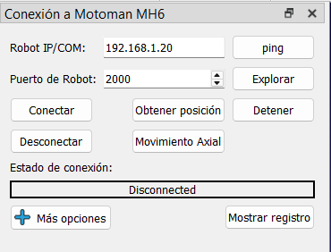

*Ejemplo de la interfaz de conexión de RoboDK al Motoman MH6. Permite introducir la IP del controlador, comprobar su accesibilidad mediante ping y gestionar la conexión. Los parámetros deben ajustarse a la configuración de la celda utilizada.*

#### Cambios del código para simular y corrección de la conexión

El código base del docente contenía errores intencionales como parte de la actividad de identificación y corrección. Durante el laboratorio no advertimos el problema de la comprobación `if not robot.ConnectedState()`. Fue al revisar posteriormente el código cuando identificamos que esta función devuelve una pareja `(estado, mensaje)`: una tupla no vacía se evalúa como verdadera incluso cuando su código de estado indica un error. Por ello, aquella condición no detectaba correctamente una conexión no disponible. Corregimos esta comprobación en el archivo del repositorio después de la práctica; la versión corregida no fue la utilizada durante la ejecución física del laboratorio.

Para simular, en [FiguraPolar.py](FiguraPolar.py) se mantiene comentado el bloque de conexión física y se ejecuta el script desde RoboDK en simulación, sin seleccionar **Ejecutar en robot**. El mensaje correspondiente es:

```python
print("Modo simulación: sin conexión al robot físico.")
```

Para ejecutar sobre el manipulador real se debe comentar el mensaje de simulación y descomentar el bloque de ejecución física, una vez verificadas la celda, la conexión y el modo REMOTE. El bloque corregido es:

```python
if not robot.Connect():
    raise Exception("No se pudo conectar al robot. Verifica el modo remoto y la configuración.")

estado, mensaje = robot.ConnectedState()
if estado != ROBOTCOM_READY:
    raise Exception("El robot no está listo: " + mensaje)

print("Robot conectado y listo para ejecución física.")
```

La comparación con `ROBOTCOM_READY` comprueba el código de estado devuelto por la API. También corregimos el mensaje de confirmación, que antes se imprimía incluso con la conexión comentada: ahora cada modalidad tiene su propio mensaje y la confirmación física queda después de la comprobación. El bloque corregido de ejecución física queda pendiente de comprobar nuevamente con el robot.

#### Configuración de la herramienta: simulación e implementación física

La línea que debe conservarse en simulación y comentarse para la ejecución física mediante el driver de Motoman es:

```python
robot.setPoseTool(robot.PoseTool())
```

La limitación está en la asignación de la herramienta mediante `setPoseTool()`: el soporte oficial de RoboDK indica que esta operación no está soportada para Motoman mediante el driver y que la herramienta debe configurarse previamente en el controlador. `PoseTool()` consulta la transformación del TCP en RoboDK; el controlador no recibe ni interpreta esa expresión de Python.

Por tanto, para la implementación física se omite esta asignación desde el script y se verifica previamente que el TCP configurado y seleccionado en el controlador corresponda al de la herramienta utilizada en RoboDK. Comentar la instrucción evita solicitar una operación no soportada, pero no elimina la necesidad de configurar correctamente la herramienta.


**Fuente:** [aclaración del soporte de RoboDK sobre `setPoseTool()` en Motoman](https://robodk.com/forum/Thread-The-behavior-of-setPoseTool-is-buggy).

#### Envío de órdenes y velocidad de comunicación

El script de Python calcula los puntos de la trayectoria y solicita los movimientos a RoboDK. Este interpreta las poses con el marco de referencia y el TCP activos, y utiliza el driver para enviar las órdenes al controlador mediante Ethernet y consultar el estado del robot.

La comunicación se caracteriza por la capacidad del enlace (Mbit/s) y la frecuencia de actualización (Hz), mientras que la velocidad del movimiento se expresa en mm/s o °/s. En la práctica se programó una velocidad lineal de **100 mm/s** mediante `robot.setSpeed(100)`; no se midió la velocidad de comunicación.

**Fuentes:** [conexión de robots Yaskawa Motoman y driver MotomanHSE](https://robodk.com/doc/en/Robots-Motoman.html), [conexión desde Python y comprobación de estado](https://robodk.com/doc/en/Robot-Drivers-How-use-Robot-Drivers.html) y [API de Python de RoboDK](https://robodk.com/doc/en/PythonAPI/robodk.html).

## 6. Comparación entre RoboDK y RobotStudio

RoboDK y RobotStudio son herramientas de simulación y programación fuera de línea. Permiten diseñar celdas robotizadas, simular trayectorias y generar el programa del robot en un computador, sin detener la producción ni exponer el equipo real. Se diferencian en su alcance (un solo fabricante frente a múltiples marcas) y en el modo de programar.


| Aspecto | RobotStudio | RoboDK |
|---|---|---|
| **Desarrollador** | ABB Robotics | RoboDK Inc. |
| **Marcas de robots** | Exclusivamente ABB | Más de 500 modelos de múltiples fabricantes (ABB, KUKA, Yaskawa/Motoman, Fanuc, Universal Robots, entre otros) |
| **Librería de robots** | Modelos ABB incluidos con el software | Librería en la nube, con descarga de los modelos que se necesiten |
| **Licencia** | De pago, con distintas modalidades (incluida una para universidades). Con el convenio entre la Universidad Nacional de Colombia y ABB, la licencia se puede solicitar fácilmente | De pago, con versión de evaluación |
| **Lenguaje de programación** | RAPID | Programas gráficos por instrucciones, bloques y Python (API) |
| **Controlador virtual** | Sí: controlador virtual idéntico al real (IRC5 / OmniCore) | No replica el controlador real: genera el programa mediante posprocesadores |
| **Precisión de la simulación** | Muy alta para robots ABB | Buena para cinemática y trayectorias; depende del posprocesador en lo específico de cada marca |
| **Conexión con el robot real** | Nativa con controladores ABB | Mediante controladores (*drivers*) para varias marcas |
| **Sistema operativo** | Windows | Windows, Linux y macOS |
| **Perfil de usuario** | Quien trabaja con robots ABB y requiere exactitud | Quien trabaja con varias marcas o necesita flexibilidad |

### 6.1. Licenciamiento

Ambos programas requieren licencia para su uso completo.

- RobotStudio: al ser un producto de ABB, ofrece varias modalidades de licencia. En el caso de la Universidad Nacional de Colombia, el convenio con ABB permite solicitar la licencia de forma sencilla, lo que lo convierte en una opción accesible para estudiantes y docentes.
- RoboDK: se licencia de forma comercial, con una versión de evaluación para probar el software antes de adquirirlo. Conviene consultar con el proveedor las condiciones académicas vigentes.

### 6.2. Tipo de programación

#### RobotStudio: lenguaje RAPID

RAPID es el lenguaje de programación textual de los robots ABB. En RobotStudio el programa se escribe, edita y depura en un editor de código, y se prueba en el controlador virtual.

```rapid
MoveJ p10, v1000, z50, tool0;
MoveL p20, v500, fine, tool0;
```

| Ventajas | Inconvenientes |
|---|---|
| Control total sobre el comportamiento del robot (comunicaciones, manejo de errores, lógica compleja) | Curva de aprendizaje mayor: hay que conocer la sintaxis y las estructuras de RAPID |
| El código es el mismo que se ejecuta en el robot real, sin conversiones | Solo sirve para robots ABB; no se reutiliza en otras marcas |
| Permite validar el programa con el controlador virtual antes de llevarlo al robot | Programar a mano trayectorias largas o complejas es más lento |
| Es el estándar para aplicaciones industriales en ABB | Requiere conocer bien el modelo de datos del robot (herramientas, sistemas de coordenadas, datos de carga) |

#### RoboDK: instrucciones, bloques y Python

RoboDK permite crear programas de forma gráfica, agregando instrucciones de movimiento (`MoveJ`, `MoveL`), de E/S y de control sobre una lista de pasos. También se pueden escribir scripts en Python que controlan la estación de trabajo mediante su API.

```python
from robodk import robolink

RDK = robolink.Robolink()
robot = RDK.Item('', robolink.ITEM_TYPE_ROBOT)
target1 = RDK.Item('Target 1')
target2 = RDK.Item('Target 2')

robot.MoveJ(target1)
robot.MoveL(target2)
```

| Ventajas | Inconvenientes |
|---|---|
| Programación accesible: por instrucciones y bloques, sin necesidad de dominar el lenguaje de cada robot | El programa se traduce al lenguaje del robot mediante un posprocesador, por lo que puede requerir ajustes |
| Python facilita automatizar tareas, procesar datos y generar trayectorias desde CAD o desde código | Algunas instrucciones muy específicas de un controlador pueden no estar soportadas o requerir personalizar el posprocesador |
| Un mismo programa se puede adaptar a robots de diferentes marcas | No simula el comportamiento completo del controlador (señales, seguridad, lógica propia del fabricante) |
| Python permite integrar visión artificial, sensores y otras librerías | Para aplicaciones avanzadas se necesita conocimiento de Python y de la API de RoboDK |

### 6.3. Compatibilidad con robots

RobotStudio trabaja específicamente con robots ABB. Esto le permite un nivel de integración muy alto con ese fabricante, pero lo limita a su ecosistema.

RoboDK trabaja con una gama extensa de robots de diferentes marcas. Los modelos están disponibles en una librería en la nube, de la cual se descargan los que se necesiten para la celda.

Para el caso de este proyecto, el Motoman MH6 solo puede trabajarse con RoboDK, ya que RobotStudio no admite robots de otras marcas.

### 6.4. RobotStudio: ventajas, inconvenientes y aplicaciones

Ventajas:

- Controlador virtual idéntico al real, que permite probar el programa RAPID con la lógica y los tiempos reales del robot.
- Integración total con los controladores ABB, incluida la conexión con el robot físico.
- Paquetes especializados por proceso (por ejemplo, soldadura por arco) que automatizan la generación de trayectorias.
- Simulación muy fiel, útil para validar una celda antes de construirla o modificarla.
- Licencia accesible para la comunidad universitaria gracias al convenio con ABB.

Inconvenientes:

- Solo funciona con robots ABB.
- Requiere aprender RAPID.
- Solo está disponible para Windows y suele necesitar un equipo con buenas prestaciones.
- Los paquetes de procesos específicos pueden implicar licencias adicionales.

Aplicaciones:

- Puesta en marcha virtual y validación de celdas robotizadas con robots ABB.
- Programación fuera de línea de soldadura/decoración, paletizado, manipulación y ensamblaje.
- Formación y prácticas en programación de robots ABB.

### 6.5. RoboDK: ventajas, inconvenientes y aplicaciones

Ventajas:

- Soporta múltiples marcas y más de 500 modelos de robots, con librería en la nube.
- Programación flexible: instrucciones, bloques y Python.
- Facilita trabajar con CAD/CAM, por ejemplo, para generar trayectorias a partir de piezas y superficies.
- Disponible en Windows, Linux y macOS

Inconvenientes:

- No reproduce el comportamiento completo del controlador del fabricante.
- La calidad del código generado depende del posprocesador de cada marca.
- Para conectarse a algunos robots reales se requieren controladores o interfaces del fabricante.
- Es menos exacto que RobotStudio en lo específico de los robots ABB.

Aplicaciones:

- Celdas con robots de distintas marcas o con cambio frecuente de modelo.
- Mecanizado, impresión 3D, soldadura, pulido y manipulación con trayectorias generadas desde CAD.
- Investigación, docencia y prototipado, donde se prueban distintos robots con un mismo entorno.
- Automatización con Python: calibración, integración con visión y generación automática de programas.

### 6.6. ¿Cuándo usar cada una?

| Situación | Herramienta recomendada |
|---|---|
| Se trabaja únicamente con robots ABB y se necesita la máxima fidelidad | RobotStudio |
| Se necesita validar lógica, señales digitales de E/S y tiempos del controlador | RobotStudio |
| La celda incluye robots de varias marcas (por ejemplo, ABB y Motoman) | RoboDK |
| Se busca programar con Python o de forma gráfica, sin aprender el lenguaje de cada fabricante | RoboDK |
| Se generan trayectorias desde modelos CAD (mecanizado, impresión 3D, soldadura) | RoboDK |

## 7. Diagrama de flujo de acciones del robot

El siguiente diagrama representa la secuencia de [FiguraPolar.py](FiguraPolar.py) en su configuración actual de simulación, con el bloque de conexión física comentado. Incluye la inicialización, las comprobaciones del robot y del marco de trabajo, los tres bucles de dibujo y el retorno a Home.

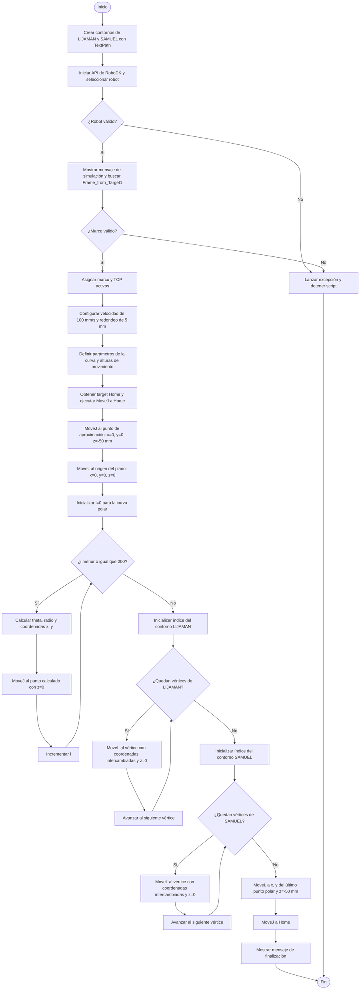

La curva se recorre con **201 puntos**, correspondientes a los índices de 0 a 200. Para cada uno se calcula:

$$
\theta = 2\pi\frac{i}{200}, \qquad
r = 100\left[\cos(2\theta)\sin(5\theta)+1.5\right]
$$

$$
x = r\sin(\theta)+300, \qquad y = r\cos(\theta), \qquad z=0
$$

Después se recorren los vértices de ambos textos con `MoveL`, usando `(y_lij[i], x_lij[i], 0)` y `(y_sam[i], x_sam[i], 0)`. Al finalizar, el movimiento de retiro utiliza las variables `x` e `y` del último punto de la curva polar, no las del último vértice del texto. Todas estas coordenadas están expresadas respecto a `Frame_from_Target1`; `z=-50 mm` corresponde a `z_surface - z_safe` en ese marco inclinado.

Como decisión del equipo, al finalizar los trazos se realiza primero un movimiento hacia el punto de aproximación asociado al último punto de la curva polar, con `z=-50 mm` respecto al marco de trabajo. Desde allí se regresa a `Home` mediante `MoveJ`.

La curva polar utiliza `MoveJ`, aunque su comentario en el código menciona `MoveL`. Las comprobaciones explícitas lanzan una excepción si el robot o el marco no son válidos; el programa no incluye una rutina propia de recuperación o retorno a Home ante fallos, ni una comprobación explícita de validez del target `Home`.

## 8. Plano de planta de la celda

### 8.1. Vista de planta


*Distribución esquemática de la celda en vista superior, sin escala. Se identifican el manipulador sobre su eje lineal de desplazamiento, el eje externo separado, el controlador, los interruptores y la maquinaria cercana.*

Los colores permiten distinguir el manipulador y el eje externo en verde, el controlador en azul, los interruptores en rojo y la maquinaria cercana en morado. El contorno negro representa el recorrido del eje lineal sobre el que se desplaza el robot completo, rotulado en la imagen como «Octavo grado de libertad».

### 8.2. Vista lateral

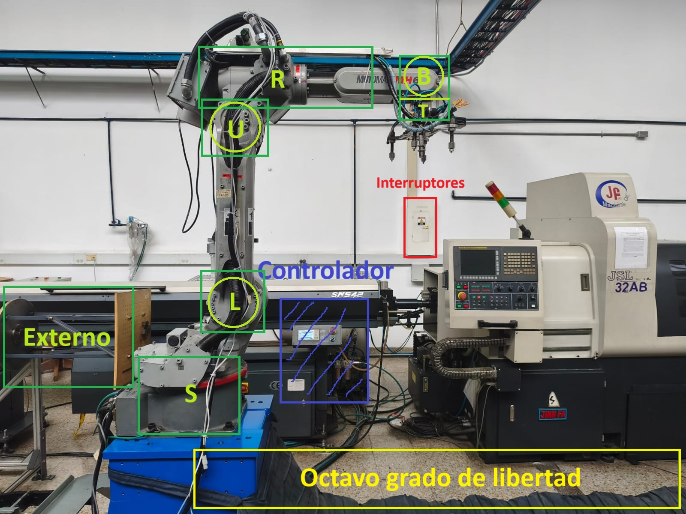

*Fotografía lateral anotada de la instalación. Se señalan las seis articulaciones del MH6 (S, L, U, R, B y T), el eje externo, el controlador, los interruptores y el sistema de desplazamiento lineal del robot.*

El manipulador MH6 tiene **seis grados de libertad rotacionales**. La instalación incorpora además un eje externo separado y un eje lineal que desplaza el robot completo, para un total de **ocho grados de libertad en el conjunto**.

## 9. Código desarrollado

El programa desarrollado en Python está disponible en [FiguraPolar.py](FiguraPolar.py). Genera los puntos de la figura polar y los contornos de los textos `LIJAMAN` y `SAMUEL`, y ejecuta la secuencia de movimientos respecto a `Frame_from_Target1`, comenzando y terminando en `Home`. Los textos identifican a los integrantes del equipo: `LIJAMAN` es el apodo de Emmanuel Bonilla Mitrotti y `SAMUEL` corresponde a Samuel David Negrete Lancheros.

El flujo de ejecución se describe en la sección 7 y los ajustes para simulación o ejecución física se documentan en la sección 5.2. El script utiliza la API de RoboDK y las bibliotecas `math` y `matplotlib`.

## 10. Videos de simulación e implementación física

[Ver Video en YouTube](https://www.youtube.com/watch?v=6KkIvW-8XNA)


En el video se muestra el diseño de una rutina que dibuja una trayectoria en coordenadas polares, su simulación y validación en RoboDK, y su ejecución física en el manipulador Motoman MH6, comandado desde el computador.

Contenido:

- Simulación de la trayectoria polar en RoboDK.
- Validación de la trayectoria y definición de los puntos de aproximación.
- Ejecución física de la trayectoria en el Motoman MH6 controlado desde el PC: aproximación, trayectoria y regreso a Home.

<!--
## Conclusiones

1. [Conclusión sustentada en la comparación técnica de los robots.]
2. [Conclusión sobre home1 / home2, operación manual y control de velocidad.]
3. [Conclusión sobre RoboDK, su comunicación y la comparación con RobotStudio.]
4. [Conclusión sobre la trayectoria polar, su validación física y las diferencias respecto a la simulación.]
 
-->

## Referencias

### Guía y material del curso

- Universidad Nacional de Colombia. *Laboratorio No. 02 - Robótica Industrial: Análisis y Operación del Manipulador Motoman MH6*. [Guía incluida en el repositorio](Laboratorio_No__02____2026_I___Robo%CC%81tica_Industrial.pdf).
- Ramírez, R. y Cárdenas, P. *Fundamentos de Robótica Industrial*. Universidad Nacional de Colombia. Diapositivas del curso sobre programación y operación básica del DX100, selección de velocidad manual y área de estado.

### Manipuladores y controlador

- MOTOMAN. *MOTOMAN-MH6: General purpose and handling*, ficha B-07-2009, apartado «Specifications MH6». [Ficha técnica del fabricante, alojada por un tercero](https://dmliefer.ru/sites/default/files/brand/booklets/mh6_en.pdf).
- ABB. *Product specification - IRB 140*, documento 3HAC041346-001, revisión Q, 2020. Secciones 1.1.2 (versiones y características generales) y 1.8 (movimiento, repetibilidad y velocidades). [Especificaciones oficiales](https://library.e.abb.com/public/a7121292272d40a9992a50745fdaa3b2/3HAC041346%20PS%20IRB%20140-en.pdf).
- Yaskawa. *DX100 Operator's Manual*, documento 155507-1CD. Secciones 1.2 «Programming Pendant» y 2.2.0.5 «Select Manual Speed». [Manual del fabricante, alojado por Walla Walla University](https://people.wallawalla.edu/~ralph.stirling/classes/engr480/docs/Motoman/dx100_operator_155507-1CD.pdf).

### RoboDK, RobotStudio y programación

- RoboDK. *Interface*. Herramientas, TCP y sistemas de referencia. [Documentación oficial](https://robodk.com/doc/en/Interface.html).
- RoboDK. *RoboDK API: robodk package*. Movimientos `MoveJ`, `MoveL` y `MoveC`, selección de marcos, herramientas y parámetros de movimiento. [API de Python](https://robodk.com/doc/en/PythonAPI/robodk.html).
- RoboDK. *Post Processors*. Instrucciones de programa, pausas y generación de código. [Documentación oficial](https://robodk.com/doc/en/PythonAPI/postprocessor.html).
- RoboDK. *Yaskawa Motoman robots*. Conexión Ethernet, driver MotomanHSE y modo REMOTE. [Documentación oficial](https://robodk.com/doc/en/Robots-Motoman.html).
- RoboDK. *How to use Robot Drivers*. Conexión desde Python y comprobación mediante `ConnectedState()` y `ROBOTCOM_READY`. [Documentación oficial](https://robodk.com/doc/en/Robot-Drivers-How-use-Robot-Drivers.html).
- RoboDK, soporte técnico. *The behavior of setPoseTool is buggy*. Respuesta de Albert del 9 de diciembre de 2024 sobre la limitación de asignación de herramientas en Motoman mediante el driver. [Foro oficial](https://robodk.com/forum/Thread-The-behavior-of-setPoseTool-is-buggy).
- ABB. *RobotStudio Desktop*. Simulación, programación fuera de línea y controlador virtual de ABB. [Descripción oficial](https://www.abb.com/global/en/areas/robotics/products/software/robotstudio-suite/robotstudio-desktop).
- Matplotlib. *matplotlib.textpath*. Generación de contornos de texto mediante `TextPath`, utilizada para los nombres del equipo. [Documentación oficial](https://matplotlib.org/stable/api/textpath_api.html).
