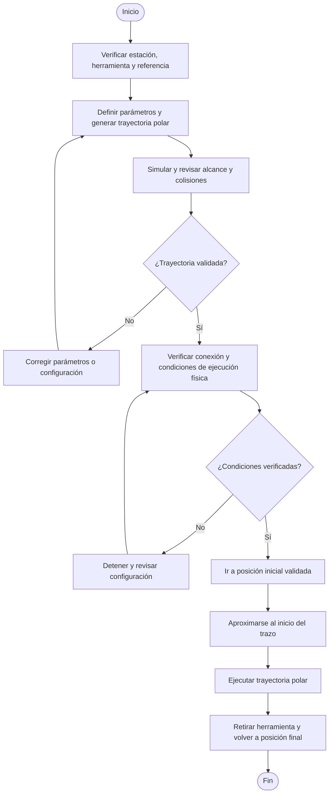

# Laboratorio No. 02 - Robótica Industrial: Motoman MH6 y RoboDK

**Fecha de la práctica:** [11/11/2026]

> Plantilla de informe basada en las tareas y los requerimientos de la guía. Reemplazar los campos entre corchetes con datos verificados, resultados y evidencias de la práctica. Las rutas del apartado de anexos son propuestas; enlazar los archivos cuando se agreguen al repositorio.

## Objetivo

Comparar el Motoman MH6 y el ABB IRB140, documentar la operación manual del Motoman y diseñar, simular y ejecutar una trayectoria polar desde RoboDK con el manipulador físico controlado desde el PC.

## Contenido

1. [Comparación técnica de los manipuladores](#1-comparación-técnica-de-los-manipuladores)
2. [Configuraciones home1 y home2](#2-configuraciones-home1-y-home2)
3. [Procedimiento de movimientos manuales](#3-procedimiento-de-movimientos-manuales)
4. [Niveles de velocidad manual](#4-niveles-de-velocidad-manual)
5. [RoboDK y comunicación con el Motoman](#5-robodk-y-comunicación-con-el-motoman)
6. [Comparación entre RoboDK y RobotStudio](#6-comparación-entre-robodk-y-robotstudio)
7. [Diagrama de flujo de acciones del robot](#7-diagrama-de-flujo-de-acciones-del-robot)
8. [Plano de planta de la celda](#8-plano-de-planta-de-la-celda)
9. [Trayectoria polar y código anexo](#9-trayectoria-polar-y-código-anexo)
10. [Videos de simulación e implementación física](#10-videos-de-simulación-e-implementación-física)

## 1. Comparación técnica de los manipuladores: Motoman MH6 vs ABB IRB 140

A continuación se presenta la comparación de las características técnicas de los dos robots industriales Motoman MH6 vs ABB IRB 140.

### Características generales

| Característica | Motoman MH6 | ABB IRB 140 |
|---|---|---|
| **Fabricante** | Yaskawa Motoman (Japón) | ABB Robotics (Suiza/Suecia) |
| **Tipo** | Articulado vertical | Articulado vertical |
| **Carga máxima (payload)** | 6 kg | 6 kg |
| **Alcance máximo** | 1422 mm | 810 mm |
| **Grados de libertad** | 6 | 6 |
| **Repetibilidad** | ±0,08 mm | ±0,03 mm |
| **Peso del robot** | ≈ 130 kg | ≈ 98 kg |
| **Controlador** | DX100 / DX200 | IRC5 |
| **Lenguaje de programación** | PYTHON (RoboDK) | RAPID |
| **Montaje** | Suelo, pared, techo | Suelo, pared, invertido, inclinado |
| **Protección** | IP54 (muñeca IP67) | IP67 |
| **Aplicaciones típicas** | Soldadura por arco, manipulación, ensamblaje, dispensado, atención de máquinas | Soldadura por arco, ensamblaje, manipulación, atención de máquinas, empaquetado, limpieza/pintura, desbarbado |

### Rango de movimiento por eje

| Eje | MH6 | IRB 140 |
|---|---|---|
| Eje 1 (base) | ±170° | ±180° |
| Eje 2 (hombro) | +155° / −90° | +110° / −90° |
| Eje 3 (codo) | +250° / −175° | +50° / −230° |
| Eje 4 (antebrazo) | ±180° | ±200° |
| Eje 5 (muñeca) | +225° / −45° | ±115° |
| Eje 6 (brida) | ±360° | ±400° |

### Velocidad máxima por eje

| Eje | MH6 | IRB 140 |
|---|---|---|
| Eje 1 | 220 °/s | 200 °/s |
| Eje 2 | 200 °/s | 200 °/s |
| Eje 3 | 220 °/s | 260 °/s |
| Eje 4 | 410 °/s | 360 °/s |
| Eje 5 | 410 °/s | 360 °/s |
| Eje 6 | 610 °/s | 450 °/s |

### Análisis

- **Alcance:** el Motoman MH6 ofrece un volumen de trabajo mucho mayor (1422 mm frente a 810 mm), ideal para celdas amplias o piezas grandes.
- **Precisión:** el IRB 140 es más preciso (±0,03 mm vs ±0,08 mm), útil en ensamblaje fino y tareas de alta exactitud.
- **Compacidad:** el IRB 140 es más ligero y compacto, con protección IP67 en todo el robot, lo que facilita su uso en espacios reducidos y entornos exigentes.
- **Carga:** ambos manejan 6 kg, por lo que la elección depende del alcance, la precisión y el ecosistema (controlador y software).
- **Programación:** el MH6 usa PYTHON; el IRB 140 usa RAPID (IRC5).

## 2. Configuraciones home1 y home2

**Definición en la celda utilizada:** [Explicar qué representan home1 y home2 y cómo se consultaron. No asumir valores a partir del nombre de la configuración.]

| Articulación del MH6 | Posición en home1 (°) | Posición en home2 (°) |
|---|---|---|
| S | [Completar] | [Completar] |
| L | [Completar] | [Completar] |
| U | [Completar] | [Completar] |
| R | [Completar] | [Completar] |
| B | [Completar] | [Completar] |
| T | [Completar] | [Completar] |

**Evidencias:** [Agregar fotografías o capturas identificadas de ambas configuraciones y de sus valores articulares.]

| Criterio | home1 | home2 |
|---|---|---|
| Separación respecto a obstáculos y mesa | [Completar] | [Completar] |
| Facilidad de acceso a la trayectoria | [Completar] | [Completar] |
| Proximidad a límites articulares o singularidades | [Completar] | [Completar] |
| Utilidad como posición de inicio y retorno | [Completar] | [Completar] |

**¿Cuál posición es mejor y por qué?** [Elegir para las condiciones de esta práctica y justificar con los valores, las evidencias y los criterios anteriores.]

## 3. Procedimiento de movimientos manuales

**Equipo utilizado:** [Modelo del controlador y del pendant; herramienta y TCP activos.]

**Condiciones previas:** [Registrar modo de operación, habilitación requerida, zona despejada y velocidad inicial según las instrucciones del laboratorio.]

### 3.1. Movimiento por articulaciones

| Paso | Acción y tecla / menú utilizado | Indicador en pantalla | Resultado observado |
|---|---|---|---|
| 1 | [Seleccionar el modo de operación requerido] | [Completar] | [Completar] |
| 2 | [Seleccionar el sistema de movimiento articular] | [Completar] | [Completar] |
| 3 | [Seleccionar la velocidad manual] | [Completar] | [Completar] |
| 4 | [Habilitar y mover una articulación en ambos sentidos; indicar teclas] | [Completar] | [Completar] |
| 5 | [Detener el movimiento y registrar la posición] | [Completar] | [Completar] |

### 3.2. Cambio a movimiento cartesiano

1. [Indicar la tecla o secuencia para cambiar del modo articular al cartesiano.]
2. [Indicar cómo seleccionar y verificar el marco de referencia: base, herramienta o usuario, según lo utilizado.]
3. [Indicar cómo verificar la herramienta / TCP activos.]
4. [Describir la habilitación y la ejecución del movimiento.]

### 3.3. Traslaciones y rotaciones

| Movimiento | Marco utilizado | Tecla / combinación positiva | Tecla / combinación negativa | Resultado observado |
|---|---|---|---|---|
| Traslación en X | [Completar] | [Completar] | [Completar] | [Completar] |
| Traslación en Y | [Completar] | [Completar] | [Completar] | [Completar] |
| Traslación en Z | [Completar] | [Completar] | [Completar] | [Completar] |
| Rotación alrededor de X | [Completar] | [Completar] | [Completar] | [Completar] |
| Rotación alrededor de Y | [Completar] | [Completar] | [Completar] | [Completar] |
| Rotación alrededor de Z | [Completar] | [Completar] | [Completar] | [Completar] |

**Evidencias:** [Insertar capturas del sistema de coordenadas seleccionado y fotografías o video de los movimientos. Explicar las etiquetas de orientación mostradas por el controlador.]

## 4. Niveles de velocidad manual

Registrar los niveles disponibles en el controlador utilizado y su indicación real en pantalla.

| Nivel / nombre mostrado | Valor y unidad, si se muestran | Tecla o secuencia de selección | Indicador y ubicación en pantalla | Uso durante la práctica |
|---|---|---|---|---|
| [Nivel 1] | [Completar] | [Completar] | [Completar] | [Completar] |
| [Nivel 2] | [Completar] | [Completar] | [Completar] | [Completar] |
| [Agregar los demás niveles disponibles] | [Completar] | [Completar] | [Completar] | [Completar] |

**Procedimiento de cambio:** [Describir paso a paso cómo aumentar y disminuir el nivel y cómo confirmar el cambio en la interfaz.]

**Evidencia:** [Agregar una captura con el indicador de velocidad señalado. Explicar si su interpretación cambia entre movimiento articular y cartesiano.]

## 5. RoboDK y comunicación con el Motoman

### 5.1. Funcionalidades principales

| Funcionalidad | Explicación | Uso o evidencia en esta práctica |
|---|---|---|
| Modelado de la estación y selección del robot | [Completar] | [Completar] |
| Definición de herramienta y marcos de referencia | [Completar] | [Completar] |
| Programación y simulación de trayectorias | [Completar] | [Completar] |
| Comprobación de alcance y colisiones | [Completar] | [Completar] |
| Generación de programas mediante postprocesador | [Completar] | [Completar] |
| Comunicación y ejecución con el robot | [Completar] | [Completar] |

### 5.2. Comunicación utilizada

| Parámetro | Configuración utilizada |
|---|---|
| Versión de RoboDK | [Completar] |
| Controlador del Motoman | [Completar] |
| Medio de conexión y configuración de red | [Completar] |
| Driver / protocolo y requisitos del controlador | [Completar] |
| Modalidad de ejecución desde el PC | [Completar] |
| Postprocesador, si se utilizó | [Completar / No aplica] |
| Verificación de conexión | [Estado mostrado y evidencia] |

**¿Qué hace RoboDK para mover el manipulador?** [Describir el recorrido desde la definición de puntos y poses hasta su ejecución: cinemática, instrucciones, driver o programa generado y función del controlador. Distinguir simulación, transferencia de programas y control en línea; indicar cuál se usó realmente.]

**Procedimiento aplicado:**

1. [Preparar la estación, herramienta y referencia.]
2. [Configurar la conexión al controlador.]
3. [Verificar el estado de conexión y la correspondencia entre la estación y el robot.]
4. [Seleccionar la modalidad de ejecución y ejecutar la rutina validada.]
5. [Registrar el resultado y la evidencia del control desde el PC.]

## 6. Comparación entre RoboDK y RobotStudio

| Criterio | RoboDK | RobotStudio |
|---|---|---|
| Fabricantes y robots compatibles | [Completar] | [Completar] |
| Programación y lenguajes / API | [Completar] | [Completar] |
| Simulación y relación con el controlador real | [Completar] | [Completar] |
| Comunicación con el robot físico | [Completar] | [Completar] |
| Herramientas de análisis y validación | [Completar] | [Completar] |
| Licencias y funciones disponibles en la versión utilizada | [Completar] | [Completar] |
| Ventajas | [Completar] | [Completar] |
| Limitaciones | [Completar] | [Completar] |
| Aplicaciones recomendadas | [Completar] | [Completar] |

**Interpretación del equipo:** [¿Qué representa cada herramienta para ustedes? Relacionar la comparación con la experiencia del laboratorio 1 y del laboratorio 2 y justificar en qué casos elegirían cada una. Citar las fuentes de las características técnicas.]

## 7. Diagrama de flujo de acciones del robot

> Esquema inicial para adaptar a la secuencia realmente implementada. Ajustar las decisiones, movimientos y condiciones de finalización al código anexo.

**Descripción:** [Explicar cada etapa y su correspondencia con las rutinas del programa. Documentar el comportamiento implementado ante una interrupción o fallo.]

## 8. Plano de planta de la celda

**Plano:** [Insertar una imagen de la vista superior de la distribución real de la celda.]

El plano debe identificar los elementos presentes, incluir dimensiones o escala, unidades, leyenda y orientación de los ejes de referencia utilizados.

| Identificador en el plano | Elemento | Ubicación / dimensiones | Función |
|---|---|---|---|
| R1 | Motoman MH6 y base | [Completar] | [Completar] |
| C1 | Controlador | [Completar] | [Completar] |
| PC1 | PC con RoboDK | [Completar] | [Completar] |
| P1 | Pendant | [Completar] | [Completar] |
| M1 | Mesa o superficie de trabajo | [Completar] | [Completar] |
| T1 | Herramienta y zona de trazado | [Completar] | [Completar] |
| [Otro] | [Otros elementos presentes y delimitaciones] | [Completar] | [Completar] |

**Relación con la simulación:** [Explicar cómo se representaron estas ubicaciones y referencias en la estación de RoboDK.]

## 9. Trayectoria polar y código anexo

**Integrantes del equipo:** Samuel David Negrete Lancheros y Emmanuel Bonilla Mitrotti.

### 9.1. Definición de la trayectoria

**Curva seleccionada y justificación:** [Completar.]

Definir la ecuación polar y su intervalo:

$$
r = f(\theta), \qquad \theta \in [\theta_0,\theta_f]
$$

Para una curva plana en el marco de trabajo, documentar la conversión utilizada:

$$
x = x_c + r(\theta)\cos(\theta), \qquad
y = y_c + r(\theta)\sin(\theta), \qquad
z = z_{\mathrm{trazo}}
$$

| Parámetro | Valor / definición |
|---|---|
| Función r(θ) | [Completar] |
| Intervalo angular y unidad | [Completar] |
| Paso angular o número de muestras | [Completar] |
| Centro y unidades de longitud | [Completar] |
| Marco de referencia y plano de la curva | [Completar] |
| Altura de trazo y de aproximación / retiro | [Completar] |
| Orientación del TCP | [Completar] |
| Tipo de movimientos y velocidad programada | [Completar] |
| Posiciones inicial y final | [Completar] |

**Gráfica de la curva:** [Insertar gráfica o captura que permita comparar el diseño con el resultado.]

### 9.2. Código y archivos anexos

El código completo debe estar adjunto en el repositorio. El archivo existente es [FiguraPolar.py](FiguraPolar.py); documentar su funcionamiento y actualizar este enlace si cambia su nombre. Completar las demás rutas y convertirlas en enlaces cuando los archivos estén disponibles.

| Archivo | Ruta propuesta | Contenido |
|---|---|---|
| Código fuente existente | [FiguraPolar.py](FiguraPolar.py) | [Describir generación de puntos y ejecución] |
| Estación de RoboDK | `RoboDK/estacion_trayectoria_polar.rdk` | [Robot, herramienta, referencias y programa] |
| Programa generado, si aplica | `Codigo/[archivo_generado]` | [Programa para el controlador y postprocesador utilizado] |
| Evidencias gráficas | `Imagenes/` | [Configuraciones home, interfaz, plano y resultados] |
| Videos locales, si se incluyen | `Video/` | [Simulación e implementación física] |

**Dependencias y preparación:** [Versiones, bibliotecas, archivos requeridos y configuración de la estación.]

**Cómo ejecutar la simulación:**

1. [Abrir la estación y cargar el código.]
2. [Configurar los parámetros y verificar nombres de robot, herramienta y referencia.]
3. [Indicar cómo iniciar la simulación y qué resultado debe observarse.]

**Cómo se ejecutó en el robot físico desde el PC:** [Documentar la secuencia real, la modalidad de comunicación, las verificaciones realizadas y la forma de detener la ejecución.]

### 9.3. Resultados y análisis

| Aspecto | Resultado simulado | Resultado físico | Diferencia / explicación |
|---|---|---|---|
| Forma y continuidad de la trayectoria | [Completar] | [Completar] | [Completar] |
| Dimensiones y ubicación del trazo | [Completar] | [Completar] | [Completar] |
| Orientación de la herramienta | [Completar] | [Completar] | [Completar] |
| Tiempo de ejecución, si se midió | [Completar] | [Completar] | [Completar] |
| Incidencias y ajustes realizados | [Completar] | [Completar] | [Completar] |

**Discusión:** [Explicar las diferencias observadas y sus causas. Identificar cuáles resultados se midieron y cuáles corresponden a observaciones cualitativas.]

## 10. Videos de simulación e implementación física

> Según la guía, los videos deben comenzar con la introducción oficial del laboratorio **LabSIR**.

| Evidencia | Enlace | Contenido y marcas de tiempo |
|---|---|---|
| Simulación en RoboDK | [Pegar URL] | [Mostrar estación, trayectoria polar y ejecución completa] |
| Implementación física controlada desde el PC | [Pegar URL] | [Mostrar ejecución desde el PC y recorrido del Motoman] |

Si se presenta un solo video con ambas evidencias, indicar el enlace y las marcas de tiempo de cada parte. Verificar que los enlaces puedan abrirse por el evaluador.

<!--
## Conclusiones

1. [Conclusión sustentada en la comparación técnica de los robots.]
2. [Conclusión sobre home1 / home2, operación manual y control de velocidad.]
3. [Conclusión sobre RoboDK, su comunicación y la comparación con RobotStudio.]
4. [Conclusión sobre la trayectoria polar, su validación física y las diferencias respecto a la simulación.]
 
## Referencias

- Guía del Laboratorio No. 02: PDF incluido en esta carpeta del repositorio.
- [Ficha técnica del Motoman MH6: título, fabricante, enlace y página consultada.]
- [Ficha técnica del ABB IRB140: título, fabricante, enlace y página consultada.]
- [Manual del controlador / pendant utilizado: versión, enlace y secciones consultadas.]
- [Documentación de RoboDK: funcionalidades, driver y postprocesador utilizados.]
- [Documentación de RobotStudio y demás fuentes consultadas.]
--> 
